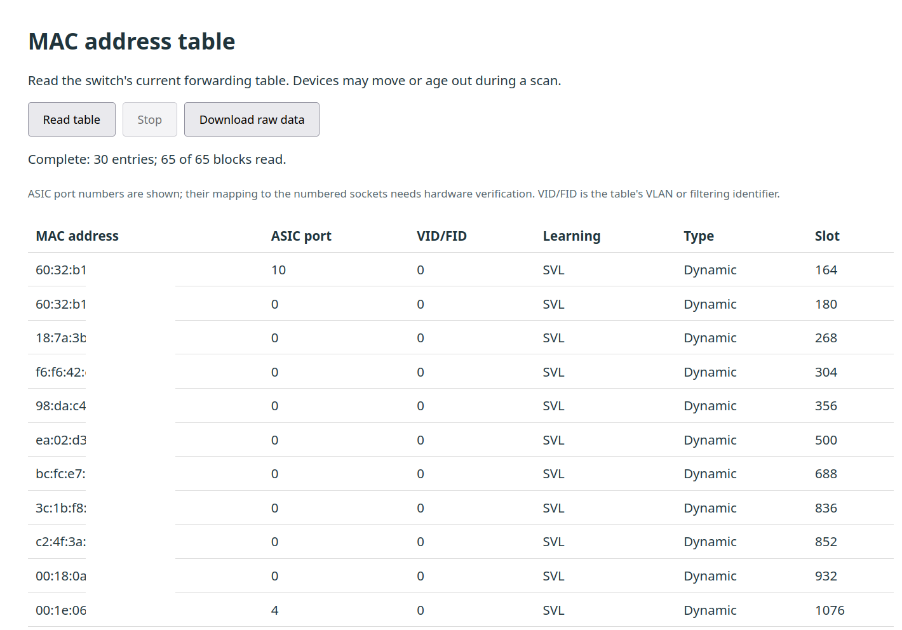

# TL-SG108E V5 MAC table

Firmware patch for the TP-Link TL-SG108E V5, based on
`1.0.0 Build 20191021 Rel.53360`. Adds a web page showing learned MAC addresses
and their ASIC ports. Flashed and tested on a TL-SG108E 5.0.



**The MAC table page is not password protected.** Anyone who can reach the
switch's web interface can read it. Restrict access to a trusted management network.

## Build

Requires Bash, Python 3.9+ and Node.js 18+. Place the original (stock) firmware in `original/`:

```text
original/TL-SG108Ev5.0_en_1.0.0_[20191021-rel.53360]_up.bin
```

Firmware binaries are excluded from Git; see [source requirements](original/README.md).

```sh
./build.sh
```

The script checks the source hash, extracts and patches the firmware, runs the
offline tests, and compares the images.

Output: [`patch/build/mac-table-experimental.bin`](patch/build/mac-table-experimental.bin)

## Use

1. Back up the configuration. Upload the patched `.bin` through
   **System → System Tools → Firmware Upgrade** on a V5 unit. Keep power connected.
2. After rebooting, open `http://SWITCH-IP/MacTableRpm.htm` and click **Read table**.
   The page is not linked from the stock menu. **Download raw data** saves the scan.

ASIC port numbers have not been mapped to the numbered sockets. Multiple MACs
on one port can be devices behind an uplink. Entries can change during a scan.

See [technical notes](REVERSE_ENGINEERING.md) for image layout, patch details,
test limits and recovery notes.

## Recovery

Board pinout, flash voltage and a recovery procedure have not been established.
Before using a programmer, identify the flash part and obtain two matching
full-chip reads. The upgrade `.bin` is not a full flash backup and must not be
written directly across the chip. The firmware's `Enter Loader Mode` string
alone does not establish a working recovery path.
